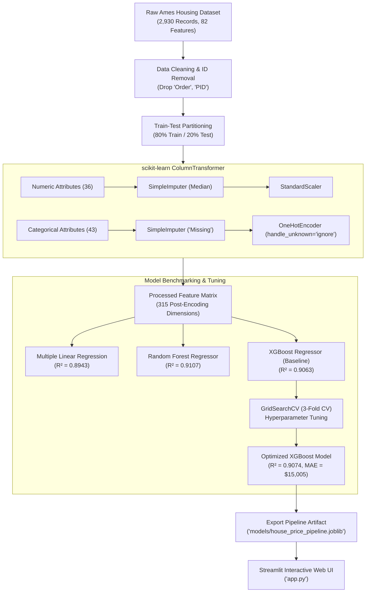

#  Ames Housing Price Prediction & Real Estate Valuation Platform

[](https://www.python.org/)
[](https://scikit-learn.org/)
[](https://xgboost.readthedocs.io/)
[](https://streamlit.io/)
[](LICENSE)

An end-to-end Machine Learning pipeline and interactive web application designed to forecast residential property valuations in Ames, Iowa using **80+ structural, spatial, and environmental features**.

The system features **automated leak-free preprocessing pipelines**, comprehensive **regression model benchmarking**, **GridSearchCV hyperparameter optimization**, and an interactive **Streamlit dashboard** for real-time property valuation.

---

##  Project Highlights

- **Zero Data Leakage Architecture**: Engineered modular `scikit-learn` `ColumnTransformer` pipelines ensuring preprocessing transformations (median/constant imputation, standard scaling, and one-hot encoding) are fitted strictly on training folds.
- **Robust Model Benchmarking**: Evaluated parametric and non-parametric architectures (Multiple Linear Regression, Random Forest Regressor, and XGBoost Regressor).
- **Hyperparameter Optimization**: Tuned tree complexity, learning rate, and estimator counts using 3-fold cross-validated grid search, achieving an **$R^2$ score of 0.9074** and **MAE of $15,005** on unseen test data.
- **Production Artifact Serialization**: Exported full inference pipeline (`Pipeline(steps=[('preprocessor', ...), ('regressor', ...)])`) with `joblib` for instant batch and single-record predictions.
- **Interactive Valuation App**: Deployed a modern Streamlit application allowing users to adjust living area, finish quality, garage capacity, and neighborhood to obtain real-time valuation estimates and confidence intervals.

---

##  Architecture & Workflow



---

##  Model Performance Benchmarking

All models were evaluated on the same held-out 20% test dataset ($N = 586$ properties):

| Model Architecture | $R^2$ Score | Mean Absolute Error (MAE) | Root Mean Squared Error (RMSE) | 3-Fold Cross-Val $R^2$ |
| :--- | :---: | :---: | :---: | :---: |
| **Multiple Linear Regression** | 0.8943 | \$15,674.41 | \$29,110.19 | 0.8840 |
| **Random Forest Regressor** | 0.9107 | \$15,767.41 | \$26,759.52 | 0.8970 |
| **XGBoost Regressor (Baseline)** | 0.9063 | \$15,320.39 | \$27,404.86 | 0.9028 |
| **XGBoost Regressor (Tuned)**  | **0.9074** | **\$15,005.00** | **\$27,246.54** | **0.9059** |

### Optimal Hyperparameters (GridSearchCV)
- `n_estimators`: `200`
- `learning_rate`: `0.1`
- `max_depth`: `3`

---

##  Key Feature Drivers

Feature importance weights extracted from the optimized XGBoost model indicate that real estate valuations are primarily driven by:

1. **Overall Material & Finish Quality (`Overall Qual`)**: Strongest positive predictor; properties rated 8–10 command disproportionate valuation premiums.
2. **Above-Grade Living Area (`Gr Liv Area`)**: Directly scales price per square foot.
3. **Basement Finish Quality (`Bsmt Qual_Ex`)**: High-finish basements provide significant market uplift.
4. **Garage Capacity (`Garage Cars` & `Garage Area`)**: 2+ car garages reflect high-demand residential standards.
5. **Kitchen Quality (`Kitchen Qual_Ex`)**: Modern, high-end kitchens serve as major appraisal drivers.

---

##  Repository Structure

```text
├── app.py                     # Streamlit interactive valuation application
├── requirements.txt           # Environment dependencies
├── .gitignore                 # Standard git ignore rules
├── README.md                  # Comprehensive project documentation
├── data/
│   └── AmesHousing.csv        # Ames Housing dataset (2,930 records)
├── models/
│   └── house_price_pipeline.joblib  # Serialized end-to-end production pipeline
├── notebooks/
│   └── exploratory_data_analysis.ipynb  # Documented Jupyter Notebook walkthrough
├── reports/
│   ├── actual_vs_predicted.png    # Test set predictions scatter plot
│   ├── benchmark_metrics.csv      # Quantitative evaluation results table
│   ├── correlation_heatmap.png    # Top numeric feature correlation matrix
│   ├── feature_importance.png     # Top 10 XGBoost feature importances
│   ├── living_area_vs_price.png   # Scatter relationship plot
│   ├── model_benchmarking.png     # Algorithm R² comparison bar chart
│   └── target_distribution.png    # SalePrice distribution plot
└── src/
    ├── __init__.py
    ├── preprocess.py          # ColumnTransformer pipelines and data loaders
    ├── train.py               # Training, benchmarking, and artifact export script
    └── predict.py             # Inference functions for programmatic prediction
```

---

##  Quickstart & Setup Guide

### 1. Clone the Repository
```bash
git clone https://github.com/priyal-vyas/ames-house-price-prediction.git
cd ames-house-price-prediction
```

### 2. Set Up a Virtual Environment
```bash
# Windows
python -m venv venv
.\venv\Scripts\activate

# macOS / Linux
python3 -m venv venv
source venv/bin/activate
```

### 3. Install Dependencies
```bash
pip install -r requirements.txt
```

### 4. Run Model Training & Evaluation
To regenerate the full pipeline, benchmark tables, and visualization plots:
```bash
python src/train.py
```

### 5. Launch the Streamlit Interactive App
```bash
streamlit run app.py
```
Open your browser at `http://localhost:8501` to test interactive house price predictions.

### 6. Programmatic Inference Example
```python
from src.predict import load_model_pipeline, predict_price

# Load production pipeline
pipeline = load_model_pipeline("models/house_price_pipeline.joblib")

# Single property feature dictionary
sample_property = {
    "Overall Qual": 8,
    "Gr Liv Area": 2100,
    "Total Bsmt SF": 1200,
    "Garage Cars": 2,
    "Year Built": 2005,
    "Neighborhood": "CollgCr",
    "Kitchen Qual": "Gd",
}

estimated_price = predict_price(sample_property, pipeline=pipeline)
print(f"Estimated Market Price: ${estimated_price:,.2f}")
```

---

##  Tech Stack

- **Language**: Python 3.10+
- **Machine Learning**: Scikit-Learn, XGBoost
- **Data Engineering & Analysis**: Pandas, NumPy
- **Visualization**: Matplotlib, Seaborn
- **Application & Deployment**: Streamlit
- **Model Persistence**: Joblib

---

##  License & Citation

This project is released under the [MIT License](LICENSE).  
Dataset provided by Dean De Cock (Truman State University), *Ames, Iowa: Alternative to the Boston Housing Data as an End of Semester Regression Project*.
